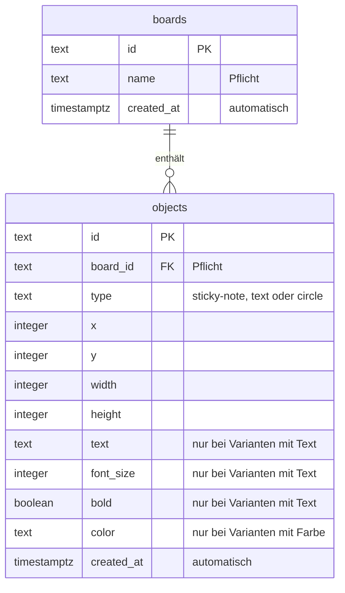

# Entity-Relationship-Modell

Die Daten liegen in Supabase (Postgres). Ein Board enthält beliebig viele Objekte, jedes Objekt gehört zu genau einem Board.

## Regeln

- **Board gelöscht → Objekte weg:** `objects.board_id` verweist mit `on delete cascade` auf `boards.id`.
- **Board bleibt fest:** Ein Objekt kann nicht auf ein anderes Board verschoben werden; `PATCH` ignoriert `board_id`.
- **IDs:** Das Frontend erzeugt die IDs neuer Boards und Objekte (`crypto.randomUUID()`). Das erste Board heißt „Mein erstes Board“ und hat die feste ID `mein-erstes-board`.
- **Leere Spalten:** Spalten, die eine Variante nicht nutzt (z. B. `text` bei einem Kreis), bleiben `null`.
- **Index:** Auf `objects.board_id` liegt ein Index, weil Objekte immer pro Board geladen werden.
- **Zugriff nur übers Backend:** RLS ist auf beiden Tabellen an, ohne Policies. Nur das Backend kommt mit dem Secret Key an die Daten.

## API

| Route | Zweck |
| --- | --- |
| `GET /boards` | alle Boards, nach Erstellung sortiert |
| `POST /boards` | Board anlegen (`id`, `name`) |
| `PATCH /boards/:id` | Board umbenennen (`name`) |
| `DELETE /boards/:id` | Board samt Objekten löschen |
| `GET /boards/:boardId/objects` | alle Objekte eines Boards |
| `POST /boards/:boardId/objects` | Objekt anlegen |
| `PATCH /boards/:boardId/objects/:id` | Objekt ändern |
| `DELETE /boards/:boardId/objects/:id` | Objekt löschen |
